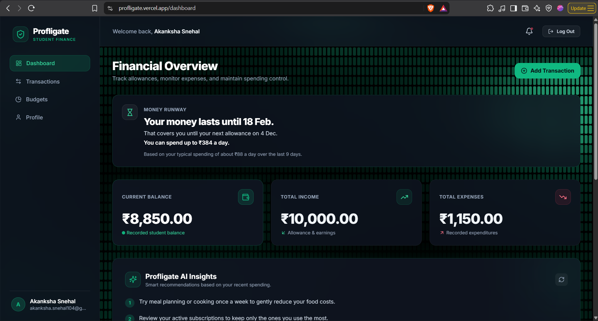
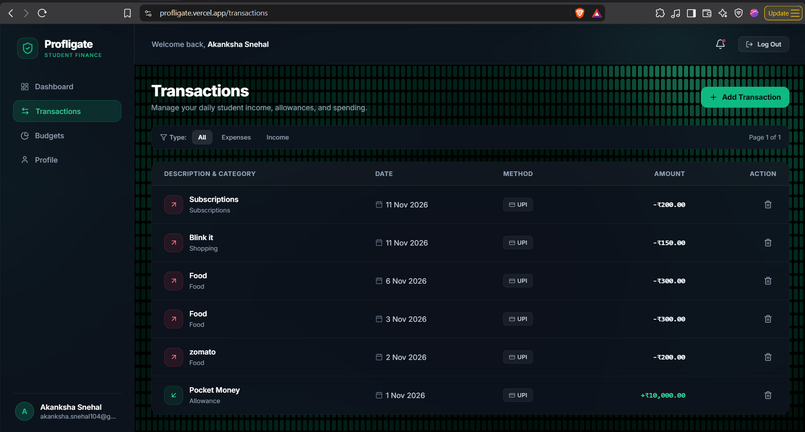
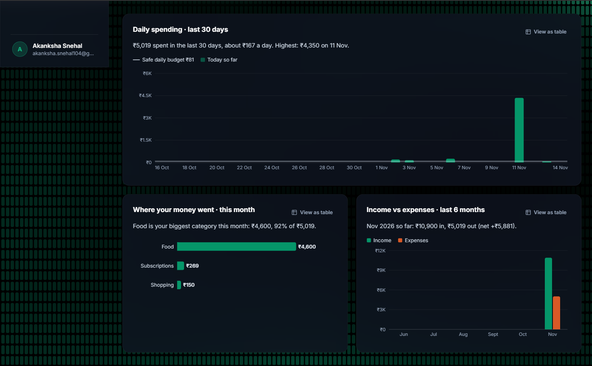
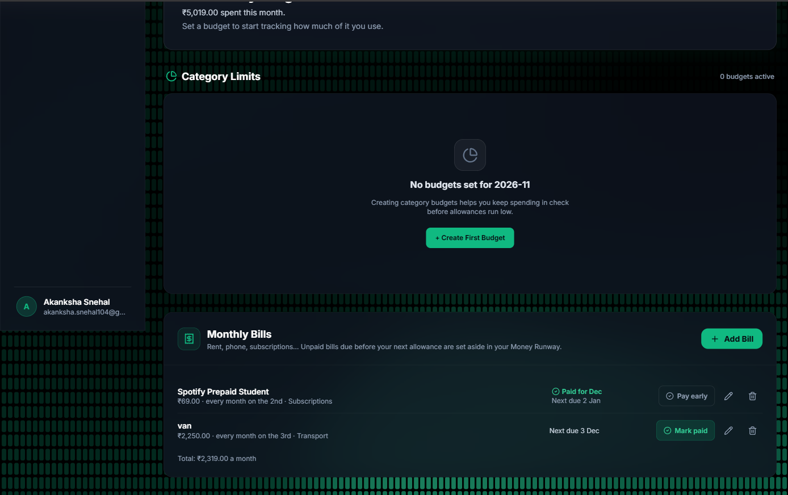
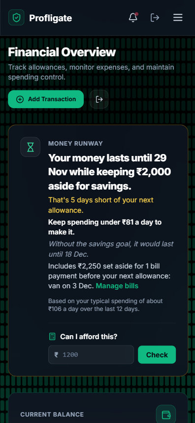

# Profligate

[](https://github.com/jiyaaa104/Profligate/actions/workflows/ci.yml)

**A student finance app that tells you when your money will run out — before it does.**

Students live on a fixed allowance, stipend or pocket money, spent in lots of small UPI payments. Most expense trackers only show what you've already spent. Profligate looks ahead instead:

- **When will my money run out?** — a forecast based on how you actually spend
- **Will it last until my next allowance?** — with your bills and savings goal set aside first
- **How much can I spend today?** — a safe daily amount
- **Can I afford this?** — the effect of a purchase before you make it

Works on desktop and phones.

**Live demo:** [profligate.vercel.app](https://profligate.vercel.app)







## Features

**Plan ahead**

- **Money Runway forecast** — "Your money lasts until 28 Nov while keeping ₹2,000 aside for savings. That's 6 days short of your next allowance. Keep spending under ₹129 a day to make it."
- **Savings goal** — set how much to keep aside each month. The forecast treats it as money you can't spend, and shows what saving costs you in days ("Without the savings goal, it would last until 10 Dec").
- **Monthly bills** — add rent, phone or subscriptions with a due day. Unpaid bills due before your next allowance are set aside in the forecast. **Mark paid** records the expense and moves the bill to next month; overdue bills are flagged, and a bill paid this month offers **Pay early** with a confirmation so it can't be paid twice by accident. Deleting the expense undoes the payment.
- **"Can I afford this?"** — type an amount to preview its effect: "After this, your money lasts until 21 Nov instead of 28 Nov. Your daily budget drops from ₹129 to ₹75." Nothing is recorded.

**See where your money goes**

- **Spending charts** — daily spending for the last 30 days against your safe daily budget, this month's spending by category, and income vs expenses for the last 6 months. Each chart has a one-line summary, hover details and a table view.
- **Transactions** — add, edit and delete income and expenses with category, payment method (UPI, card, cash…) and date; filter by type. Shown as a table on wide screens and as cards on phones.
- **Monthly budgets** — set an overall limit or per-category limits and track how much you've used. Spending outside your budgeted categories is shown separately, never counted as overspending.

**Stay on track**

- **Alerts** — in-app notifications when a day's spending passes your daily limit, or when your money won't last until your next allowance (at most once every 3 days).
- **AI insights** — short, personalised saving tips generated by Google Gemini from your recent spending (can be turned off in Profile).
- **Accounts** — sign-up with email verification, password reset by email, login lockout after repeated failures, and secure cookie-based sessions.
- **Works on phones** — every page adapts to small screens, with full-width panels and large tap targets.

## How the Money Runway works

The forecast lives in [`src/utils/runway.js`](src/utils/runway.js):

1. **Balance** = opening balance + all income − all expenses.
2. **Set aside first**, in this order:
   1. **Bills** — every unpaid bill due before your next allowance (or in the next 30 days if you haven't set an allowance day).
   2. **Savings goal** — your monthly goal, from whatever is left.
3. **Spendable money** = what remains after the set-asides.
4. **Spending pace** = average daily spending over the last 14 *complete* days (today is excluded because it isn't finished yet). Bill payments are left out, since bills are already set aside.
5. **One-off costs don't skew it** — any single day counts as at most 3× a typical spending day, so paying an ₹8,000 fee doesn't predict you'll go broke tomorrow.
6. **Run-out date** = today + spendable money ÷ pace.
7. If you set an **allowance day** (e.g. the 1st), it compares the run-out date with your next allowance and works out a **safe daily amount**. A "31st" allowance or bill falls on the last day of shorter months.
8. **"Can I afford this?"** runs the same calculation as if the amount had been spent today, so the preview always matches the card.
9. When you add an expense and the forecast falls short, you get a notification — at most once every 3 days.

It needs at least 7 days of history and 3 days with spending before it makes a forecast.

## Tech stack

| Layer | Technology |
| --- | --- |
| Frontend | React 18, Vite, Tailwind CSS, TanStack Query, React Router, Axios, Recharts |
| Backend | Node.js, Express 5, Mongoose |
| Database | MongoDB Atlas |
| AI | Google Gemini (`@google/genai`) with structured JSON output |
| Email | Brevo transactional email, Mailgen templates |
| Testing & CI | Node's built-in test runner, GitHub Actions |
| Hosting | Vercel (frontend and API as separate projects) |

## Engineering decisions

- **Money is stored as integer paise** (₹1 = 100 paise), never as floating-point rupees, so totals never drift by fractions of a paisa.
- **Timezone-aware days** — daily limits, bills, charts and the runway forecast use each user's own timezone (default `Asia/Kolkata`) to decide where a day starts and ends.
- **Nothing counted twice** — an expense created by marking a bill paid is linked to that bill, so it's excluded from the spending pace and deleting it marks the bill unpaid again.
- **Same-origin API** — the frontend's Vercel project rewrites `/api/*` to the backend project, so the browser only talks to one origin. Auth cookies stay first-party and work in privacy-focused browsers like Brave and Safari that block third-party cookies.
- **Secure sessions** — HttpOnly access and refresh token cookies. Refresh tokens are stored server-side, single-use (rotated on every refresh) and expire automatically via a MongoDB TTL index. The client refreshes expired sessions transparently and shares one refresh request across parallel calls.
- **Brute-force protection** — 5 failed logins lock the account for 15 minutes; email verification and password-reset tokens are stored as SHA-256 hashes.
- **Accessible charts** — every chart has a text summary, a table view and a screen-reader label; chart colours were checked for contrast and colour-blind separation against the dark theme. The charting library loads only when the dashboard opens.
- **Responsive layout** — checked page by page at phone width (375 px): no sideways scrolling, transactions switch from a table to cards below 1024 px, and buttons meet comfortable touch sizes.
- **Handles a slow or restarting server** — the app pings the API as soon as the login page opens, shows a "Starting up the server…" banner if it's slow, and safely resends only requests that can't create duplicates.
- **Reliable AI output** — Gemini responses are constrained to a JSON schema and retried on temporary failures.

## Running locally

**Prerequisites:** Node.js 22+, a MongoDB connection string, and (optionally) Brevo and Gemini API keys.

```bash
git clone https://github.com/jiyaaa104/Profligate.git
cd Profligate
npm install
npm install --prefix client
```

Create a `.env` file in the project root:

```env
PORT=8000
NODE_ENV=development
MONGO_URI=mongodb+srv://...

CLIENT_URL=http://localhost:5173
CORS_ORIGIN=http://localhost:5173

ACCESS_TOKEN_SECRET=change-me
ACCESS_TOKEN_EXPIRY=15m
REFRESH_TOKEN_SECRET=change-me-too
REFRESH_TOKEN_EXPIRY=7d

BREVO_API_KEY=        # verification and password-reset emails
MAIL_FROM_EMAIL=
GEMINI_API_KEY=       # AI insights
```

Start the API and the frontend in two terminals:

```bash
npm run dev
```

```bash
npm run dev --prefix client
```

Open [http://localhost:5173](http://localhost:5173). In development, Vite proxies `/api` to the API on port 8000.

## Tests

```bash
npm test
```

43 tests built on Node's own test runner (no extra dependencies) cover the money logic and the APIs around it:

- **Money Runway:** spending pace and one-off spikes, allowance dates (including the 31st and allowance-due-today), savings goal, alerts
- **Monthly bills:** due dates, overdue bills, setting bills aside before savings, mark paid and undo
- **"Can I afford this?"** previews, **transaction editing**, the **Budgets summary**, and the **dashboard charts** data

The tests replace the database with in-memory stubs and freeze the clock at a fixed date, so they need no MongoDB or API keys and give the same result every day. GitHub Actions runs them, plus a frontend build, on every push and pull request to `main` ([`.github/workflows/ci.yml`](.github/workflows/ci.yml)).

## API overview

All routes are under `/api/v1`. Everything except auth and the health check requires a logged-in user.

| Area | Endpoints |
| --- | --- |
| Auth | `POST /auth/register`, `/auth/login`, `/auth/refresh`, `/auth/logout`, `/auth/forgot-password`, `/auth/reset-password`, `/auth/change-password`; `GET/POST /auth/verify-email` |
| User | `GET /users/me`, `PATCH /users/me` (profile, allowance day, savings goal, alerts) |
| Transactions | `GET /transactions`, `POST /transactions`, `PATCH /transactions/:id`, `DELETE /transactions/:id` |
| Bills | `GET /fixed-costs`, `POST /fixed-costs`, `PATCH /fixed-costs/:id`, `DELETE /fixed-costs/:id`, `POST /fixed-costs/:id/pay` |
| Budgets | `GET /budgets`, `POST /budgets`, `PATCH /budgets/:id`, `DELETE /budgets/:id` |
| Dashboard | `GET /dashboard/summary`, `GET /dashboard/runway` (add `?purchasePaise=` for a "Can I afford this?" preview), `GET /dashboard/charts` |
| Notifications | `GET /notifications`, `PATCH /notifications/read` |
| AI | `GET /ai/insights` |
| Health | `GET /healthcheck` |

## Project structure

```text
Profligate/
├── src/                  # Express API
│   ├── controllers/      # Request handlers
│   ├── models/           # Mongoose schemas (users, transactions, budgets, bills…)
│   ├── routes/           # Route definitions
│   ├── middlewares/      # Auth (JWT) and validation
│   ├── validators/       # express-validator rules
│   └── utils/            # Runway forecast, chart data, alerts, email, helpers
├── client/               # React + Vite frontend
│   ├── src/pages/        # Dashboard, Transactions, Budgets (incl. bills), Profile, Auth
│   ├── src/components/   # Layouts and animated background
│   ├── src/services/     # Axios instance with token refresh
│   ├── src/utils/        # Shared wording and calculations for the UI
│   └── vercel.json       # SPA routing and /api rewrite
├── tests/                # Automated tests (npm test)
├── .github/workflows/    # CI: tests and frontend build
└── docs/                 # Product requirements (PRD.md) and screenshots
```

## Roadmap

- Tests for authentication flows
- Installable mobile app (PWA)
- Recurring income (e.g. adding your allowance automatically) and CSV export

The full product spec, including design decisions and requirements, is in [docs/PRD.md](docs/PRD.md).

## Acknowledgements

The animated background is adapted from [Micro Slats](https://reactbits.dev/backgrounds/micro-slats) by [React Bits](https://github.com/DavidHDev/react-bits) (MIT License).

## Author

**Akanksha Snehal** — [GitHub](https://github.com/jiyaaa104)
